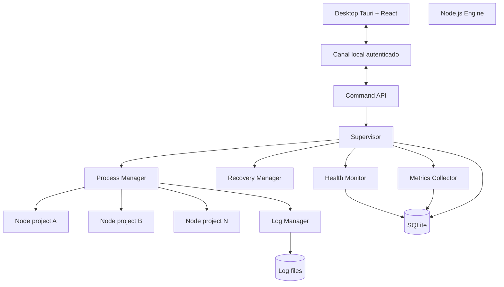

# 02 — Arquitetura geral

## 1. Separação de responsabilidades

O produto possui dois processos principais:

1. **Desktop:** Tauri 2 + React. Responsável por apresentação e interação.
2. **Engine:** processo Node.js independente. Responsável por persistência, supervisão, processos, health checks, logs e políticas.

A interface nunca deve ser dona dos processos gerenciados.

## 2. Diagrama lógico



## 3. Engine como autoridade

O Engine é a fonte de verdade do estado em execução. A UI pode manter cache para renderização, mas não deve inferir estado apenas de um clique.

Toda ação segue:

1. UI envia comando.
2. Engine valida comando e estado atual.
3. Engine executa operação.
4. Engine persiste evento/estado.
5. Engine responde com resultado.
6. Engine emite evento de atualização.

## 4. Monorepo

Usar pnpm workspaces.

```text
local-server-manager/
  apps/
    desktop/
      src/
      src-tauri/
    engine/
      src/
  packages/
    contracts/
    config/
    database/
    validation/
    shared/
  docs/
  tests/
  scripts/
```

### `apps/desktop`

- React, páginas, componentes, hooks, stores e cliente da API.
- Não chamar `child_process` para iniciar projetos.
- Não guardar credenciais permanentes em localStorage.
- Tauri fornece integração de janela, tray e instalador.

### `apps/engine`

- Processo Node.js em background.
- Bootstrap, API local, supervisor e módulos operacionais.
- Não importar código da interface.

### `packages/contracts`

- Tipos de comandos, eventos, DTOs e estados compartilhados.
- Sem dependência de Node.js, Tauri ou React.

### `packages/config`

- Leitura, validação e normalização das configurações.

### `packages/database`

- Schema, migrações e repositórios SQLite.

### `packages/validation`

- Schemas Zod de entrada e validações de domínio.

## 5. Comunicação

Preferência no Windows: Named Pipe com ACL restrita ao usuário atual. Alternativa para desenvolvimento: HTTP em `127.0.0.1` com token aleatório, validação de origem e WebSocket autenticado.

Não escutar em `0.0.0.0`. Não oferecer acesso remoto no MVP.

O protocolo deve ser independente do transporte:

- Command request/response.
- Domain events.
- Versionamento de protocolo.

## 6. Inicialização e recuperação do Engine

No MVP, instalar uma tarefa do Agendador de Tarefas do Windows para iniciar o Engine no login do usuário. O Engine inicia projetos `startOnBoot=true`.

A interface pode abrir o Engine se não estiver ativo, mas deve primeiro verificar se já existe uma instância. Evitar Engines duplicados com mutex/lock do sistema e mecanismo de eleição.

Evolução futura: serviço Windows por meio de wrapper confiável, se houver requisito de iniciar antes do login.

## 7. Concorrência e isolamento

- Um erro de projeto deve ser capturado no escopo daquele projeto.
- Eventos internos devem ser processados por filas ou handlers que não bloqueiem o event loop.
- Start/stop/restart simultâneos do mesmo projeto devem ser serializados.
- Operações em lote devem limitar concorrência configurável.
- A persistência deve evitar escrita concorrente inconsistente.

## 8. Portabilidade futura

A primeira versão é Windows-first. Evitar espalhar lógica específica de Windows nos módulos de domínio. Criar adaptadores de plataforma para:

- spawn/encerramento de árvore de processos;
- inicialização automática;
- resolução de executáveis;
- identificação de PID e métricas;
- paths e permissões.
