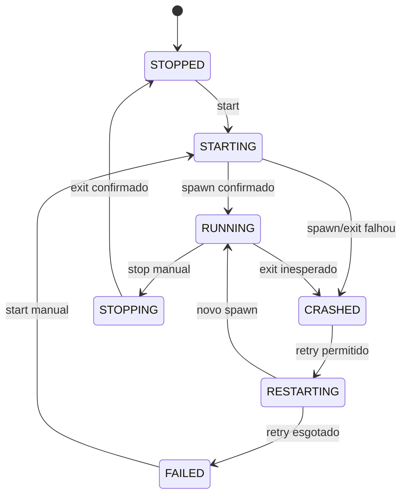

# 04 — Ciclo de vida, estados e recuperação

## 1. Estados

Estados operacionais:

- `STOPPED`
- `STARTING`
- `RUNNING`
- `STOPPING`
- `CRASHED`
- `RESTARTING`
- `FAILED`

Saúde deve ser dimensão separada:

- `UNKNOWN`
- `HEALTHY`
- `UNHEALTHY`

Na UI, combinar estado e saúde, por exemplo: `RUNNING · UNHEALTHY`.

## 2. Transições válidas

> **Implementação (ADR-013):** além do diagrama, existem
> `CRASHED --> FAILED` (retries esgotados), `RESTARTING --> STARTING` (o retry
> passa pelo spawn normal) e `RESTARTING --> STOPPING` (stop manual durante o
> backoff). Durante a espera do backoff o projeto permanece em `RESTARTING`.

## 3. Regras invariantes

- Stop manual marca `desiredState=STOPPED` antes de enviar sinal de encerramento.
- Restart manual é uma operação controlada: parar instância anterior e iniciar nova.
- Crash só é inesperado se `desiredState=RUNNING`.
- Uma instância antiga não pode sobrescrever estado de uma nova. Usar `instanceId`/generation token em callbacks.
- Evento `exit` pode ocorrer antes/depois de `close`; tratar idempotentemente.
- O mesmo projeto não pode ter dois starts concorrentes sem política explícita.
- Falha ao iniciar deve registrar erro e não entrar em loop infinito sem backoff.

## 4. Política de restart

Configuração recomendada inicial:

- enabled: true;
- maxRetries: 5;
- baseDelayMs: 2000;
- maxDelayMs: 30000;
- stableAfterMs: 60000;
- jitterRatio: 0.15;
- resetRetriesAfterStable: true.

Fórmula base:
`delay = min(baseDelay * 2^(attempt-1), maxDelay)`

Aplicar jitter opcional para evitar sincronização de muitos projetos. Em ambiente local, jitter pode ser desligado por padrão para previsibilidade.

## 5. Contagem de tentativas

Implementado conforme ADR-013:

- Uma tentativa é uma nova chamada de `spawn`.
- `maxRetries` conta reinícios após a primeira execução. Com `maxRetries=5`, a 1ª falha agenda retry (attempt 1) e a 6ª falha esgota (`FAILED`).
- Start manual após `FAILED` zera o ciclo de retry e registra evento.
- Stop manual durante o backoff cancela o timer e leva a `STOPPED`.
- Após `stableAfterMs` em execução contínua, o contador é resetado quando `resetRetriesAfterStable=true`. `stableAfterMs<=0` desliga o reset para evitar loop infinito.
- Falha de spawn (`SPAWN_FAILED`) usa o mesmo caminho de recuperação do crash.

## 6. Health failure

Health check falhar não é igual a processo cair.

Configurações:

- `failureThreshold`: quantidade de falhas seguidas;
- `timeoutMs`;
- `intervalMs`;
- `restartOnUnhealthy`;
- `unhealthyRestartCooldownMs`.

Se `restartOnUnhealthy=true`, registrar `HEALTH_RESTART_REQUESTED` e usar o mesmo mecanismo de restart controlado. Aplicar cooldown para evitar reinícios contínuos por endpoint mal configurado.

## 7. Encerramento no Windows

Tentar primeiro encerramento cooperativo quando o processo suporta mecanismo apropriado. No Windows, sinais POSIX não têm a mesma semântica de Unix. Implementar adaptador de plataforma e estratégia de encerramento de árvore de processos.

Sequência:

1. marcar STOPPING;
2. enviar mecanismo gracioso configurado;
3. aguardar `gracefulTimeoutMs`;
4. encerrar árvore de processos;
5. aguardar confirmação;
6. registrar timeout/resultado.

Não matar processo externo que apenas ocupa a porta configurada. A árvore encerrada deve pertencer à instância iniciada pelo Engine.

## 8. Recuperação após crash do próprio Engine

Implementado na Fase 2 (ADR-012):

1. No boot, instâncias sem encerramento registrado são finalizadas no banco como `CRASHED` / `EXIT_UNEXPECTED`, com evento `engine.reconciliation.detected`.
2. Propriedade de processo vivo só é reconhecida quando o `StartTime` do PID coincide com `pid_started_at` (tolerância de 2 s).
3. O Engine **não adota** e **não mata** processos que não pode comprovar como seus.
4. Órfão comprovado bloqueia `startOnBoot` daquele projeto no boot atual para evitar duas instâncias; start manual continua possível e auditado.
5. PID vivo sem propriedade comprovada é tratado como possível reuso de PID: gera aviso e não bloqueia o boot.
6. Projetos `startOnBoot=true` (exceto bloqueados) iniciam após a reconciliação.
7. Nunca assumir que PID antigo continua válido: no Windows o PID pode ter sido reutilizado.
